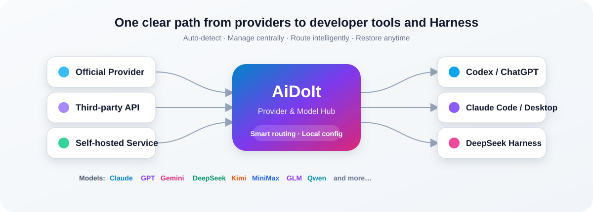

<div align="center">


<br />

[简体中文](README.md) · [English](README.en.md) · [日本語](README.ja.md) · [한국어](README.ko.md) · [Deutsch](README.de.md) · [العربية](README.ar.md) · [Español](README.es.md)

<br />

[](https://github.com/AiDoIt-Platform/AiDoIt/releases/latest)
[](https://github.com/AiDoIt-Platform/AiDoIt/releases/latest)
[](HelpMd/Ubuntu/README.md)
[](#-보안과-개인정보-보호)
[](LICENSE)

### AI 코딩 도구와 모델을 하나의 앱에서

AiDoIt은 **Windows 및 Ubuntu x64 / ARM64**를 지원합니다. Windows에서는 **Codex, ChatGPT, Claude Code, Claude Desktop, DeepSeek Harness**를 한곳에서 관리하고, Ubuntu 서버에서는 Codex와 Claude Code를 빠르게 배포할 수 있습니다.

[지금 다운로드](https://github.com/AiDoIt-Platform/AiDoIt/releases/latest) · [빠른 시작](#-빠른-시작) · [이미지 가이드](#-문서) · [문제 신고](https://github.com/AiDoIt-Platform/AiDoIt/issues/new)

</div>

---

## ✨ AiDoIt을 선택하는 이유

| 기능 | 제공하는 가치 |
|---|---|
| **Windows + Ubuntu** | Windows 10/11과 Ubuntu x64 / ARM64 CLI 환경 지원 |
| **통합 제어 센터** | 설정 파일을 반복해서 수정하지 않고 Codex, Claude, DeepSeek Harness 관리 |
| **자동 감지** | 설치된 데스크톱 앱, CLI, 로그인 상태, 로컬 런타임 검색 |
| **여러 Provider와 모델** | Provider, 자격 증명, 모델 목록을 분리하고 기본값을 언제든 전환 |
| **활성화 전 테스트** | 적용하기 전에 실제 사용 가능 여부와 응답 시간 확인 |
| **독립된 설정** | Codex, Claude, Harness가 서로 간섭하지 않도록 별도 관리 |
| **안전한 복원** | 라우팅 전 원래 상태를 저장하고 비활성화 시 공식 설정 복원 |
| **앱 내 업데이트** | `v0.0.7`부터 이후 안정 버전을 앱에서 확인하고 설치 |
| **로컬 비밀 정보** | Provider API Key는 기기에 보관되며 UI에 전체 값이 표시되지 않음 |

<br />



## 📦 다운로드 및 설치

### Windows 10/11 x64

현재 Windows 안정 버전은 **AiDoIt v0.1.3**입니다. [GitHub Releases](https://github.com/AiDoIt-Platform/AiDoIt/releases/latest)에서만 다운로드하세요.

| 패키지 | 권장 용도 | 다운로드 |
|---|---|---|
| `AiDoIt_0.1.3_x64-setup.exe` | 대부분의 사용자에게 권장하는 표준 설치 프로그램 | [Setup EXE](https://github.com/AiDoIt-Platform/AiDoIt/releases/download/v0.1.3/AiDoIt_0.1.3_x64-setup.exe) |

> [!TIP]
> 체크섬 검증, 덮어쓰기 업그레이드, 제거 방법은 [Windows 설치 가이드](HelpMd/Windows/Installation/README.md)를 참고하세요.

#### Windows v0.1.3 주요 변경 사항

- Claude 하위 에이전트 라우팅을 수정했습니다. 하위 에이전트 식별자가 있는 요청은 현재 Provider의 `claude-sonnet-5-5`를 사용하고 주 세션은 기존 모델을 유지합니다. 추가 환경 변수는 필요하지 않으며 모델 제공 여부는 Provider에 따라 다릅니다.
- Codex 하위 에이전트는 현재 모델 목록에서 전체 `ProviderID::모델ID` 또는 가상 계정에 할당된 슬롯 ID를 선택할 수 있습니다. 알 수 없거나 유효하지 않은 모델은 로컬에서 명확한 오류를 반환합니다.
- Windows에 mac 브랜치 업데이트를 반영하면서 `.cmd` / `.exe` 실행, PATH, Unicode/UNC 경로, 프로세스 트리 정리 등 플랫폼 지원을 유지합니다.

[v0.1.3 Release](https://github.com/AiDoIt-Platform/AiDoIt/releases/tag/v0.1.3) · [Windows 전체 릴리스 노트](https://github.com/AiDoIt-Platform/AiDoIt/releases/download/v0.1.3/windows-ota-release-notes.md)

Windows OTA가 `0.1.3`으로 업데이트되었으며 기존 업데이트 공개 키를 그대로 사용합니다. 동일한 채널과 공개 키를 사용하는 이전 버전에서는 앱 내에서 업데이트를 확인할 수 있습니다. 위의 설치 프로그램으로 덮어쓰기 업그레이드할 수도 있습니다. [Windows OTA 채널](https://github.com/AiDoIt-Platform/AiDoIt/releases/tag/windows-ota-stable) · [공개 업데이트 매니페스트](https://github.com/AiDoIt-Platform/AiDoIt/releases/download/windows-ota-stable/windows-latest.json)

### macOS (Apple Silicon)

[AiDoIt v0.1.3 DMG 다운로드](https://github.com/AiDoIt-Platform/AiDoIt/releases/download/v0.1.3/AiDoIt_0.1.3_aarch64.dmg)

AiDoIt을 Applications로 드래그하세요.

Claude 하위 에이전트 모델 라우팅을 수정하고 주 세션의 모델은 유지합니다. 식별자가 있는 하위 에이전트 요청은 현재 Provider의 `claude-sonnet-5-5`를 사용하며 제공 여부는 Provider에 따라 다릅니다. Codex 하위 에이전트는 현재 모델 목록에서 선택할 수 있고 목록 밖의 모델은 로컬에서 차단됩니다.

[OTA 업데이트 패키지](https://github.com/AiDoIt-Platform/AiDoIt/releases/download/v0.1.3/AiDoIt_0.1.3_aarch64.app.tar.gz) · [SHA-256 체크섬](https://github.com/AiDoIt-Platform/AiDoIt/releases/download/v0.1.3/macos-ota-SHA256SUMS.txt) · [macOS 전체 릴리스 노트](https://github.com/AiDoIt-Platform/AiDoIt/releases/download/v0.1.3/macos-ota-release-notes.md)

macOS OTA가 `0.1.3`으로 업데이트되었습니다. 동일한 업데이트 채널과 공개 키를 사용하는 이전 버전에서는 앱 내에서 업데이트를 확인할 수 있습니다. [macOS OTA 채널](https://github.com/AiDoIt-Platform/AiDoIt/releases/tag/mac-ota-stable) · [공개 업데이트 매니페스트](https://github.com/AiDoIt-Platform/AiDoIt/releases/download/mac-ota-stable/latest-macos.json)

이 빌드는 ad-hoc 서명을 사용하며 Apple 공증을 받지 않았습니다. 처음 실행할 때 마우스 오른쪽 버튼을 클릭하고 열기를 선택해야 할 수 있습니다.

### Ubuntu x64 / ARM64

온라인 스크립트로 Codex, Claude Code 또는 둘 다 설치합니다.

```bash
curl -fsSL https://service.aidoit.pro/install | bash
```

제거할 때는 설치 전에 저장된 사용자 설정을 복원할 수 있습니다.

```bash
curl -fsSL https://service.aidoit.pro/uninstall | bash
```

> [!IMPORTANT]
> `curl | bash`는 원격 스크립트를 직접 실행합니다. 도메인과 출처를 확인한 뒤 전체 [Ubuntu 이미지 가이드](HelpMd/Ubuntu/README.md)를 따르세요.

## 🚀 빠른 시작

### Windows

1. AiDoIt을 설치하고 실행한 뒤 로컬 도구와 로그인 상태 감지를 기다립니다.
2. **Codex 연동**, **Claude Code 연동** 또는 **DeepSeek Harness**를 엽니다.
3. 신뢰할 수 있는 Base URL과 API Key로 Provider를 추가합니다.
4. 모델을 가져오거나 추가한 뒤 먼저 사용 가능 여부를 테스트합니다.
5. 기본 Provider와 모델을 선택하고 연동을 활성화합니다.
6. 비활성화하면 활성화 전 공식 설정으로 복원할 수 있습니다.

### Ubuntu

1. Codex 또는 Claude Code를 실행할 일반 사용자로 서버에 로그인합니다.
2. 위 명령을 실행하고 `sk` 또는 `account` 로그인을 선택합니다.
3. 배포 대상으로 `both`, `codex`, `claude` 중 하나를 선택합니다.
4. `codex` 또는 `claude`를 실행하고 `/model`로 모델을 선택해 테스트합니다.

| 원하는 작업 | 시작 문서 |
|---|---|
| Codex / ChatGPT에서 Provider 모델 사용 | [Windows Codex 가이드](HelpMd/Windows/Codex/README.md) |
| Claude Code / Desktop에서 Provider 모델 사용 | [Windows Claude 가이드](HelpMd/Windows/Claude/README.md) |
| Ubuntu에서 Codex / Claude Code 구성 | [Ubuntu 설치 및 사용](HelpMd/Ubuntu/README.md) |

## 🧩 핵심 기능

<details open>
<summary><strong>Codex 및 ChatGPT 연동</strong></summary>

- Codex, ChatGPT, Codex CLI와 현재 로그인 상태 자동 감지.
- 공식 모델과 외부 Provider 모델을 함께 사용.
- Codex 설치, 선택, 실행과 활성화 전 실제 모델 테스트 지원.
- 앱 사용 중에는 정상 종료 또는 강제 종료를 선택해 계속 진행.

</details>

<details>
<summary><strong>Claude Code 및 Claude Desktop</strong></summary>

- Claude Code 자동 감지, 설치, 실행.
- Claude Desktop을 감지해 열거나 로컬 설치 파일을 직접 선택.
- Claude Provider, 모델, 자격 증명을 Codex 설정과 분리.
- 연동 비활성화 시 이전 설정과 모델 구성 복원.

</details>

<details>
<summary><strong>DeepSeek Harness 관리</strong></summary>

- DeepSeek Harness Web 설치, 시작, 중지, 열기 관리.
- Provider, 자격 증명, 모델, 기본 모델을 독립적으로 관리.
- 모델의 컨텍스트와 추론 능력을 표시하고 실제 응답 테스트 실행.
- 기존 Harness Agent, 도구, 세션, 작업 기록은 변경하지 않음.
- 실행 중인 설정을 보호하고 중지 후 다시 편집 가능.

</details>

<details>
<summary><strong>Provider 및 모델 관리</strong></summary>

- 여러 Provider의 엔드포인트, 키, 모델, 활성 상태를 별도로 관리.
- 업스트림 모델을 자동으로 가져오거나 목록을 직접 편집.
- 자격 증명을 다시 입력하지 않고 즐겨찾기와 기본 모델 전환.
- 중국어와 영어 UI를 즉시 전환하고 선택을 기억.

</details>

## 📚 문서

| 플랫폼 | 가이드 |
|---|---|
| Windows | [설치 및 업그레이드](HelpMd/Windows/Installation/README.md) · [Codex](HelpMd/Windows/Codex/README.md) · [Claude](HelpMd/Windows/Claude/README.md) |
| macOS | [Codex](HelpMd/macOS/Codex/README.md) · [Claude](HelpMd/macOS/Claude/README.md) |
| Ubuntu | [설치, 구성 및 테스트](HelpMd/Ubuntu/README.md) |

[AiDoIt 도움말 센터](HelpMd/README.md)에서도 플랫폼별 문서를 찾을 수 있습니다.

## 🔐 보안과 개인정보 보호

- Provider API Key와 관련 설정은 기기에 남으며 전체 키는 UI에 표시되지 않습니다.
- Codex, Claude, Harness의 자격 증명과 설정은 서로 분리됩니다.
- 연동 전 상태를 저장하고 나중에 공식 설정으로 복원할 수 있습니다.
- Issue, 로그, 스크린샷을 공유하기 전에 키, 사용자 이름, 로컬 경로, 서비스 주소를 가리세요.

> [!IMPORTANT]
> AiDoIt은 로컬 설정과 라우팅을 관리합니다. 외부 Provider로 전송되는 요청에는 해당 서비스의 개인정보 정책, 요금, 약관이 적용됩니다. 신뢰할 수 있는 Provider만 사용하세요.

## ❓ 자주 묻는 질문

<details>
<summary><strong>공식 설정을 덮어쓰나요?</strong></summary>

연동을 활성화할 때 원래 상태를 저장하고 비활성화할 때 복원할 수 있습니다. Codex, Claude, Harness는 독립적으로 관리됩니다.

</details>

<details>
<summary><strong>모델 감지 또는 테스트가 실패하는 이유는 무엇인가요?</strong></summary>

Base URL, API Key, 네트워크 연결, Provider의 필수 프로토콜 지원 여부를 확인하세요. 전체 키를 공개하지 마세요.

</details>

## 💬 문의 및 피드백

- 프로젝트: [AiDoIt-Platform/AiDoIt](https://github.com/AiDoIt-Platform/AiDoIt)
- 문제 및 제안: [Issue 만들기](https://github.com/AiDoIt-Platform/AiDoIt/issues/new)
- 이전 버전: [GitHub Releases](https://github.com/AiDoIt-Platform/AiDoIt/releases)
- 라이선스: [GNU GPL v3](LICENSE)

<div align="center">

**AiDoIt — 모든 모델을 더 간편하게 AI 개발 워크플로에 연결하세요.**

</div>
